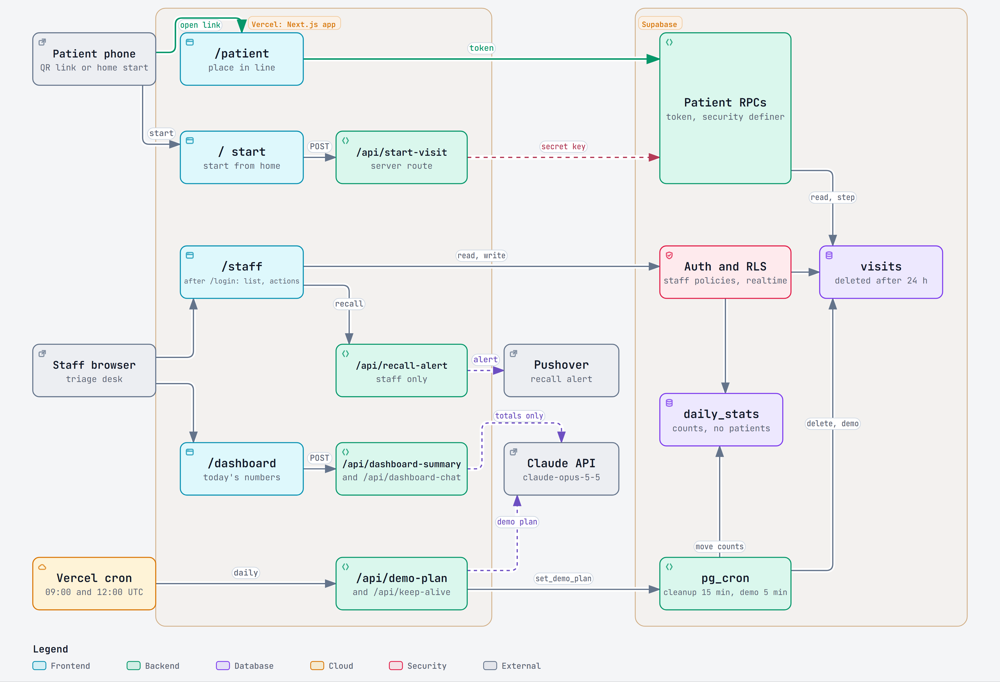
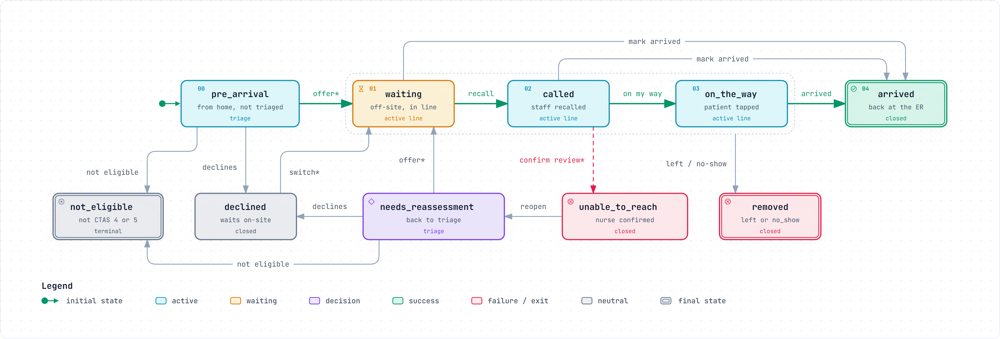

# WaitWell: A virtual ER waiting room

Try it: [waitwell-er.vercel.app](https://virtual-er-izpf.vercel.app) (demo data only).

WaitWell is a concept prototype. It shows how a hospital emergency department could let some patients wait off-site after triage. Triage is the first check a nurse does when a patient arrives. Patients who are experiencing a minor health concern, rated CTAS level 4 or 5 (the Canadian Triage and Acuity Scale), can go home or wait elsewhere. They follow their place in line on their phone. When staff are ready, they recall the patient, and the patient comes back to the hospital.

This is a concept prototype. It uses only invented (synthetic) patients and demo data. It connects to no hospital system. It is not for real patients, and it is not affiliated with any hospital.

## What it does

Patient screens (on a phone, no login):

- The start page has an emergency check, other care options and a "Start a visit" button. The app makes a visit code and a QR code, and saves them in the phone's browser.
- The patient screen (/patient) shows the place in line, an estimated wait range and the status: "Waiting", "Please head back now" or "Ready at the desk". The wait range is simulated.
- When the patient is called, they tap "I'm on my way". While they wait off-site, a prompt asks them to tap "I'm still here" every 30 minutes.
- After a visit is closed, a patient who waited off-site and arrived answers one survey question, from 0 to 10.

Staff screens (login needed):

- /staff: check in a patient after triage. Staff scan the QR code or type the short code, choose CTAS 4 or 5, tick the eligibility checklist and choose a language.
- Staff can recall a patient, mark a patient arrived or removed, and follow up when a patient does not reply. They can issue a new link for a lost phone, pause off-site waiting for one site, and recall all off-site patients at once.
- /dashboard: four key numbers per site, with the rest under "More numbers" (closed at first). It also has a funnel of today's counts, wait bands, one past-7-days table with a Site switch, and a CSV download. It has a Real view and a Demo view. Real and demo visits are never mixed.
- A demo simulator plays both sides at Demo Site A and Demo Site B, so the screens look busy. Each site has its own day shape in Toronto time: Site A is busiest around midday, and Site B is busiest in the evening. A daily factor from the date makes one site busier than the other, and that changes from day to day. Staff can clear all demo data with one button.

Languages: English, French, Urdu, Arabic and Chinese (Simplified). Urdu and Arabic screens run right to left. Only English is marked as checked by a fluent speaker. The other four show a draft notice until a fluent speaker checks them.

Accessibility features:

- Text size control at 100%, 125% and 150%.
- Labels on all controls, and visible focus.
- Status changes are read out by screen readers. The "called back" message is announced at once.
- Every alert also appears as words on the screen. Sound and vibration are extra.
- An offline banner shows when the phone loses its connection.
- Pages reflow on a small phone, without sideways scrolling.

## Safety rules

These rules come from SPEC.md. They always apply.

1. No real personal or health information. Each visit has a 6-character display code and a long random token. Names, health card numbers, phone numbers and symptoms are not stored. Only staff can look up a visit by its short code.
2. The app never makes clinical decisions. Staff choose the CTAS level and confirm eligibility. There is no symptom checker and no AI triage.
3. Every patient screen, in every state and every language, shows this line: "If your symptoms get worse, call 911 or come back to the emergency department now."
4. Visits older than 24 hours are deleted automatically. Their totals are kept in a daily statistics table, with no codes, tokens or single-visit times.
5. A patient's token can read only its own visit. Everything else, including the queue, is for staff only.
6. Joining from home never holds a place in the line. A place in line starts when a nurse triages the patient.
7. No hospital logos or official branding.
8. The app does not copy or show any hospital's wait-time numbers. All wait estimates in the app are simulated.
9. The accessibility target is WCAG 2.2 AA. That means keyboard access, visible focus, labelled controls, enough colour contrast and a layout that still works at 200% text size.

The only message that leaves the app is a Pushover alert to the project owner's phone when staff recall a real visit. It carries only the display code and the site. It never carries the token, a link, the language or the CTAS level.

The footer on every page says the app is a concept prototype, not affiliated with any hospital, with demo data only.

## Tech stack

- Next.js 16.4.6 (App Router) with React 19.3.0 and TypeScript.
- Tailwind CSS 4.3.3 for styling.
- Supabase for the database, realtime updates and staff login. The packages are supabase-js 2.119.0 and supabase ssr 0.12.7.
- Vercel for hosting. The file vercel.json sets two scheduled jobs. Vercel Web Analytics is also included.
- Pushover for the recall alert. The Anthropic SDK (version 1.12 or later) powers the dashboard summary button.
- Vitest 5.1 for unit tests, with happy-dom for page tests.
- Playwright 1.65 for end-to-end tests, and axe-core 4.14.0 for accessibility checks.
- ESLint 9 for lint.
- GitHub for the code and for the checks that run on every push.

## Checks

Run these in the project folder. Each one is a script in package.json.

- `npm test` runs the unit tests with Vitest. There are 1017 unit tests. The output lines that matter are the "Test Files" and "Tests" lines.
- `npm run lint` checks the code with ESLint. A clean run prints nothing.
- `npm run build` makes the production version of the app. It stops with an error if the build fails.
- `npm run e2e` runs 39 end-to-end tests with Playwright. The tests open the app at phone size (390 by 844) and at laptop size. They start their own server on port 3100, and they need the E2E_ settings in `.env.local`.
- `npm run e2e:cleanup` reads the file .e2e-codes.txt, which lists the test visits. It prints SQL lines. Run the first line in the Supabase SQL Editor to delete the test visits. Run the second line, which counts them. The count must be 0. Then delete .e2e-codes.txt. The script is scripts/e2e-cleanup.mjs.

GitHub runs `npm test`, `npm run lint` and `npm run build` on every push and every pull request. The file is .github/workflows/checks.yml. GitHub needs no keys for these checks.

## Folder map

- app/: the screens (one folder per screen, each with a page.tsx file) and the api/ routes that run on the server.
- components/: shared pieces, such as buttons, the footer, the 911 line, and the staff and dashboard parts.
- data/: saving and loading. This holds the Supabase calls, the browser storage and the demo data.
- lib/: the rules that decide things. Each rule is a small function with a test. lib/text/ holds all patient text, one file per language.
- supabase/: migrations/ holds the database changes, and checks/ holds the permission checks.
- scripts/: dev.mjs starts the development server, and e2e-cleanup.mjs prints the test cleanup steps.
- e2e/: the end-to-end tests, run with Playwright.
- docs/: progress.md (where the project stands), decisions.md (settled choices) and known-issues.md (gotchas and their fixes).
- handoffs/: reviews waiting for an answer from an AI model. handoffs/archive/ holds the finished ones.
- notes/, research_notes/ and reports/: earlier research.
- screenshots/: test screenshots.
- .claude/: settings for Claude Code, its worker agents and its skills.
- .github/workflows/: the checks that GitHub runs.

## Diagrams

App architecture: the screens, the server routes, Supabase and the external services, and how they connect.

Visit status lifecycle: each status a visit can have, and the moves between them. The list of moves is ALLOWED_MOVES in lib/allowedSteps.ts.

## Status and limitations

- The project is in Phase 5: testing with real people and writing this README. Phases 2, 3 and 4 are closed. Phase 4 added the dashboard, the survey and the demo mode.
- The translations for French, Urdu, Arabic and Mandarin wait for a fluent human reviewer. Safety messages are checked first.
- Wait ranges are simulated. They do not come from a real hospital.
- Sound and vibration work only while the page is open and the phone is unlocked. The app cannot wake a locked phone. The Pushover alert is the only message that can reach a locked phone, and it goes to the project owner's phone only.
