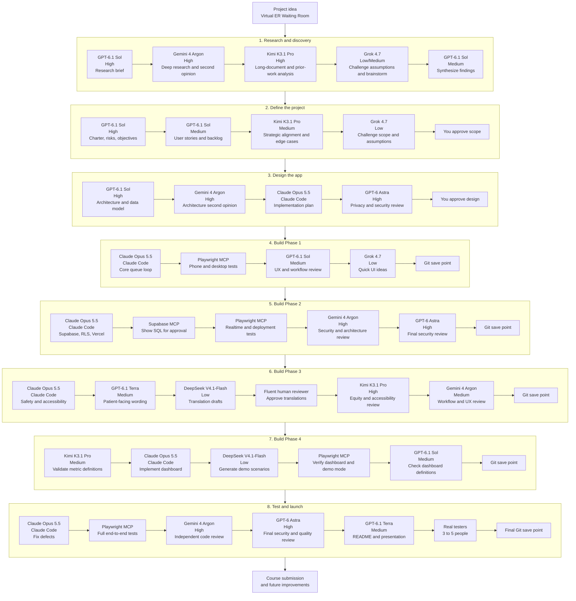

# Revised AI Model Workflow — Virtual ER Waiting Room

## Recommended model stack

| Model | Role in project | Best tasks | Effort |
|---|---|---|---|
| **GPT-6.1 Sol** | Default research and planning model | Research briefs, project charter, user stories, requirements, workflow design, explaining code, routine reviews | **Medium** normally; **High** for research synthesis and important reviews |
| **Claude Opus 5.5 + Claude Code** | Primary builder | Build and debug the Next.js/Supabase/Vercel app, manage phases, run Playwright tests, make controlled changes | Agent workflow; one coding agent at a time |
| **Gemini 4 Argon** | Deep-analysis and second-opinion model | Deep research, architecture review, complex debugging, long-horizon coding, multimodal/document analysis | **High** for hard problems; **Medium** for analysis |
| **Kimi K3.1 Pro** | Long-context specialist | Analyzing the full briefing, comparing many documents, financial/business analysis, strategic alignment, equity review | **Medium**; **High** for complex review |
| **GPT-6 Astra** | Final quality gate | Final security/privacy review, final code review, high-stakes decisions | **High** |
| **GPT-6.1 Terra** | Writing and documentation | README, presentation, patient-facing wording, survey questions, polished summaries | **Medium** |
| **Grok 4.7** | Fast ideation and alternative views | Brainstorming names/features, challenging assumptions, quick code explanations, generating test ideas | **Low/Medium** |
| **DeepSeek V4.1-Flash** | Low-cost utility | Translation drafts, bulk test scenarios, summaries, simple extraction | **Low** |
| **GPT-5.6 Cyber / GPT-6 Cyber** | Security specialist only | Optional authorized security review; not general research or app building | Only if specifically needed |

## Why this stack

- **GPT-6.1 Sol** is the best everyday balance of research, planning, coding knowledge, and cost. Use it as the default model for most non-coding work.
- **Claude Code + Claude Opus 5.5** remains the primary builder because it is already integrated with the project’s Supabase, Vercel, Playwright, and documentation tools.
- **Gemini 4 Argon** adds a strong independent second opinion for architecture, difficult debugging, long-horizon coding, and multimodal analysis.
- **Kimi K3.1 Pro** is best for reviewing the entire briefing, SPEC, related projects, and research papers together because of its long-context strength.
- **GPT-6 Astra** is reserved for the highest-stakes reviews and final quality gates.
- **Grok 4.7** is a fast challenger and brainstorming partner, not the main builder.
- **DeepSeek V4.1-Flash** handles inexpensive, high-volume work.
- **Cyber models** are specialized for authorized security work and should not be used as general research models.

## Full lifecycle workflow



## Stage-by-stage usage

### 1. Research and discovery

- **GPT-6.1 Sol, High:** Produce a structured research brief on virtual ER waiting rooms, patient recall workflows, privacy, accessibility, and adoption.
- **Gemini 4 Argon, High:** Independently challenge the research brief and identify missing perspectives.
- **Kimi K3.1 Pro, High:** Analyze the full briefing, related projects, and research papers together.
- **Grok 4.7, Low/Medium:** Challenge assumptions, identify unnecessary scope, and propose alternative approaches.
- **GPT-6.1 Sol, Medium:** Turn the findings into a concise “what we will build and why” summary.

### 2. Define the project

- **GPT-6.1 Sol, High:** Create the project charter, objectives, constraints, assumptions, risks, milestones, and success measures.
- **GPT-6.1 Sol, Medium:** Convert the charter into patient, nurse, project-manager, and privacy-officer user stories.
- **Kimi K3.1 Pro, Medium:** Check strategic alignment with THP’s Plan to 2030 and identify overstated claims.
- **Grok 4.7, Low:** Challenge scope, budget, timeline, and feature assumptions.
- **You:** Approve the scope before coding begins.

### 3. Design the app

- **GPT-6.1 Sol, High:** Design pages, data model, access-control model, realtime update pattern, and dashboard calculations.
- **Gemini 4 Argon, High:** Independently review the architecture and identify risks or simpler alternatives.
- **Claude Opus 5.5 / Claude Code:** Turn the design into a concrete implementation plan and file structure.
- **GPT-6 Astra, High:** Review privacy, security, and safety gaps before implementation.
- **You:** Approve the design and any database changes.

### 4. Build Phase 1: prototype

- **Claude Opus 5.5 / Claude Code:** Build the core loop: staff check-in, patient screen, call back, “I’m on my way,” and arrival.
- **Playwright MCP:** Test at 390 x 844 phone size and laptop size.
- **GPT-6.1 Sol, Medium:** Review the user flow for confusing labels, missing states, and workflow gaps.
- **Grok 4.7, Low:** Suggest simpler UI patterns or identify unnecessary complexity.
- **Git:** Commit after each working change.

### 5. Build Phase 2: database and deployment

- **Claude Opus 5.5 / Claude Code:** Implement Supabase, realtime updates, staff login, RLS, and Vercel deployment.
- **Supabase MCP:** Show SQL and security policies before running changes.
- **Playwright MCP:** Verify that staff and patient views update within about two seconds.
- **Gemini 4 Argon, High:** Review the security architecture and implementation approach.
- **GPT-6 Astra, High:** Perform the final security review after Phase 2.
- **Git:** Save a known-good version before continuing.

### 6. Build Phase 3: safety and equity

- **Claude Opus 5.5 / Claude Code:** Implement safety line, emergency check, no-response ladder, “I’m still here,” call-everyone-back, languages, text size, accessibility labels, footer, and 24-hour deletion.
- **GPT-6.1 Terra, Medium:** Draft clear patient-facing UI copy and survey wording.
- **DeepSeek V4.1-Flash, Low:** Produce first-draft translations and test scenarios.
- **Fluent human reviewer:** Approve final translations, especially safety messages.
- **Kimi K3.1 Pro, High:** Review accessibility, plain language, equity, and the full patient journey.
- **Gemini 4 Argon, Medium:** Review workflow consistency and UX gaps.

### 7. Build Phase 4: dashboard and demo mode

- **Kimi K3.1 Pro, Medium:** Validate dashboard definitions against the charter objectives.
- **Claude Opus 5.5 / Claude Code:** Implement dashboard queries, summary cards, demo mode, and daily_stats logic.
- **DeepSeek V4.1-Flash, Low:** Generate 15–20 synthetic visits and expected dashboard outcomes.
- **Playwright MCP:** Verify demo mode and dashboard behavior.
- **GPT-6.1 Sol, Medium:** Check that each dashboard metric has a clear definition and supports a project objective.

### 8. Test, review, and launch

- **Claude Opus 5.5 / Claude Code:** Fix defects and improve reliability.
- **Playwright MCP:** Run full end-to-end tests, including called/no-response, unable-to-reach, reopening after return, survey eligibility, and call-everyone-back.
- **Gemini 4 Argon, High:** Perform an independent code and architecture review.
- **GPT-6 Astra, High:** Perform the final security, privacy, accessibility, and code-quality review.
- **GPT-6.1 Terra, Medium:** Write the README, presentation narrative, and demo instructions.
- **Real testers:** Have 3–5 people use the app and report confusion, errors, or accessibility problems.

## Operating rules

### Default loop

```text
GPT-6.1 Sol, Medium
Plan / clarify / write tasks
        ↓
Claude Opus 5.5 + Claude Code
Build one small change
        ↓
Playwright MCP
Test phone and desktop
        ↓
GPT-6.1 Sol, Medium
Review the result
        ↓
Git commit
```

### Escalation loop

Use this when the task is important, ambiguous, or Claude Code is stuck:

```text
GPT-6.1 Sol, High
Analyze the problem
        ↓
Gemini 4 Argon, High
Independent second opinion
        ↓
Kimi K3.1 Pro, High
Long-document / strategic analysis if needed
        ↓
Grok 4.7, Low/Medium
Challenge assumptions and propose alternatives
        ↓
You decide
        ↓
Claude Opus 5.5 + Claude Code implements
```

## Guardrails

- Do not use Cyber models for normal research or coding.
- Do not let two coding agents edit the repository at once.
- Do not use AI-generated translations as final; have fluent speakers review safety-critical text.
- Do not let an AI model make clinical decisions; the nurse selects CTAS and eligibility.
- Do not use Max effort routinely; use Medium for normal work and High for consequential analysis.
- Do not treat any AI security review as proof of compliance or safety; verify findings and use them as input to human review.
- Keep prompts free of real patient data, API keys, tokens, passwords, or confidential hospital information.

## Immediate next steps

1. Use **GPT-6.1 Sol at High** to create a research brief on virtual ER waiting rooms, patient recall workflows, privacy considerations, and accessibility requirements.
2. Use **Gemini 4 Argon at High** to challenge that brief and identify missing risks.
3. Use **Kimi K3.1 Pro at High** to compare the briefing, SPEC, and related projects.
4. Use **Grok 4.7 at Low** to challenge scope and propose a simpler five-week build.
5. Use **GPT-6.1 Sol at Medium** to create the final project charter, user stories, and phase plan.
6. Use **Claude Code + Claude Opus 5.5** to begin Phase 1.
